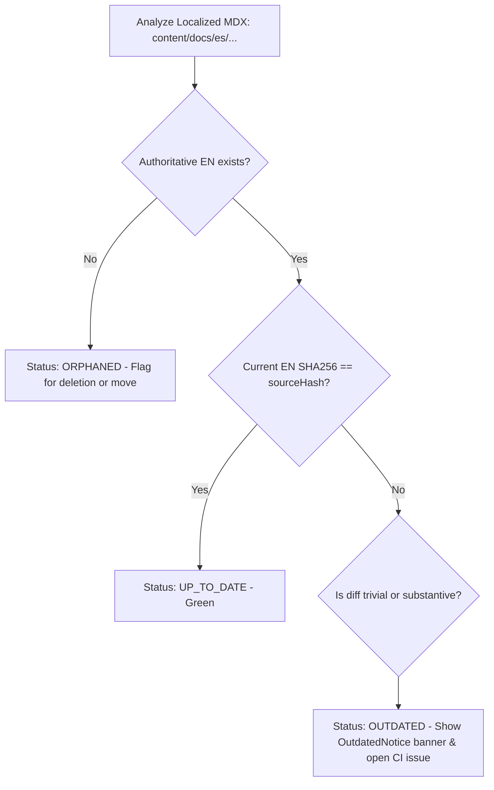

# Architecture and Technical Design

**Project:** `chatflow-agent-web`  
**Purpose:** Official multilingual documentation and website platform for `chatflow-agent` (Open-Source Python library for conversational AI agents, tools, sessions, and channel integrations).  
**Authoritative SDK Repository:** [https://github.com/GustavoBaranda/chatflow-agent](https://github.com/GustavoBaranda/chatflow-agent)  
**Status:** Architectural Blueprint (Phase 0 - Revised)  
**Authoritative Language:** English  

---

## 1. Executive Summary & Core Directives

`chatflow-agent-web` is the official multilingual documentation platform and public web presence for `chatflow-agent`. It is architected for extreme performance, accessibility, contributor simplicity, and internationalization scalability.

### Confirmed Architectural Directives
1. **Exclusively Local Boundary:** Zero remote pushes, zero remote releases, zero cloud deployments during initial development.
2. **Package Manager Standard:** Strict adoption of **`pnpm`** (`>=9.15.0`) for fast, deterministic, space-efficient dependency management with frozen lockfiles.
3. **Explicit Locale Routing:** All languages carry explicit route prefixes (`/en/`, `/es/`). Visiting `/` deterministically negotiates and redirects to the appropriate prefixed route (`/en/...` or `/es/...`).
4. **Authoritative Python SDK Source:** All API references, method signatures, parameter names, and runnable code examples must be verified against published releases/tags of [https://github.com/GustavoBaranda/chatflow-agent](https://github.com/GustavoBaranda/chatflow-agent). Hallucinating or inventing Python SDK capabilities is strictly prohibited.
5. **Decoupled Architecture:** The web platform has zero runtime dependency on the Python SDK package or backend databases for the initial MVP.
6. **Future Playground Boundary:** The interactive agent playground is maintained solely as an architectural boundary. No playground components, runtimes, or dependencies are introduced in this phase.

---

## 2. Technology Stack & Modern Stable Verification

The technology stack is aligned with current modern stable releases, avoiding outdated dependencies while maintaining verified inter-package compatibility:

| Layer | Selected Technology | Target Version | Technical Justification & Compatibility Notes |
| :--- | :--- | :--- | :--- |
| **Runtime & Engines** | Node.js + pnpm | Node `>=20.18.0` (LTS)<br/>pnpm `>=9.15.0` | Enforced via `"engines"` in `package.json` and Corepack. Guarantees 100% reproducible local environments across contributors. |
| **Framework** | Next.js (App Router) | `^16.4.3` | React Server Components (RSC) by default, Turbopack support, asynchronous dynamic `params`, and optimized Static Site Generation (SSG). |
| **UI Library** | React | `^19.3.1` | Native React 19 compatibility with Next.js 16 and modern component rendering. |
| **Doc Engine** | Fumadocs | `fumadocs-ui ^16.17.8`<br/>`fumadocs-core ^16.17.8`<br/>`fumadocs-mdx ^15.4.10` | Modern headless documentation engine built specifically for Next.js App Router, MDX, and Tailwind CSS. Fully compatible with Next.js 16 async `params` and React 19. |
| **UI Internationalization** | `next-intl` | `^4.14.9` | App Router-native i18n with ICU message syntax, type-safe catalogs, and full support for Next.js 16 async `params` and `setRequestLocale(locale)`. |
| **Styling & Design System** | Tailwind CSS | `^4.3.3` (`@tailwindcss/postcss`) | CSS-first configuration model (`@import "tailwindcss";`, `@theme`, `@source`), lightning-fast Oxide compiler engine, zero runtime CSS footprint, and native Fumadocs UI preset compatibility. |
| **Search Engine** | Fumadocs / Orama Search | Embedded / Client-side | Offline-capable, zero-SaaS, build-time MDX AST indexing with multilingual tokenization and local verification. |
| **Unit & Integration Testing** | Vitest | `^5.0.5` | ESM-native test runner, instant feedback, compatible with React Testing Library. |
| **End-to-End Testing** | Playwright | `^1.64.1` | Cross-browser automated testing (Chromium, Firefox, WebKit) and accessibility auditing via `@axe-core/playwright`. |
| **Code Quality** | ESLint + Prettier | ESLint `^9.20.0` (Flat Config)<br/>Prettier `^3.5.0`<br/>TypeScript `^5.9.3` | Enforces TypeScript strictness, import sorting, Tailwind class ordering, and accessibility linting (`eslint-plugin-jsx-a11y`). |

---

## 3. Fumadocs & next-intl Compatibility Architecture

Combining **`next-intl`** and **Fumadocs** requires a clear, well-tested integration boundary:

### 3.1 Division of Responsibilities
* **`next-intl` (Application Shell & Navigation):**
  - Handles HTTP request locale negotiation and URL redirects via `src/middleware.ts`.
  - Manages application chrome UI strings: global header, navigation links, theme toggle, language dropdown, footer, and community pages via `messages/en.json` and `messages/es.json`.
  - Enforces explicit prefix routing: `localePrefix: 'always'`.
* **Fumadocs (Content Layer & MDX Engine):**
  - Resolves MDX documentation source trees from `content/docs/[locale]/`.
  - Computes localized table-of-contents, frontmatter parsing (Zod), and sidebar navigation trees (`meta.json`).
  - Renders MDX components, syntax-highlighted code blocks, and localized search dialogs.

### 3.2 Handling Next.js 15 Asynchronous Route Parameters
Next.js 15 treats `params` as a `Promise`. The documentation layout and catch-all dynamic page adhere to this specification:

```tsx
// src/app/[locale]/docs/[[...slug]]/page.tsx
import { source } from '@/lib/source';
import { notFound } from 'next/navigation';
import { setRequestLocale } from 'next-intl/server';
import { DocsPage, DocsBody, DocsTitle, DocsDescription } from 'fumadocs-ui/page';
import { TranslationNotice } from '@/components/docs/TranslationNotice';
import { OutdatedNotice } from '@/components/docs/OutdatedNotice';

interface PageProps {
  params: Promise<{
    locale: string;
    slug?: string[];
  }>;
}

export async function generateStaticParams() {
  return source.generateParams();
}

export default async function Page({ params }: PageProps) {
  const { locale, slug = [] } = await params;
  setRequestLocale(locale);

  // Attempt to resolve page in requested locale
  let page = source.getPage(slug, locale);
  let isFallback = false;

  // Fallback to authoritative English if localized MDX does not exist
  if (!page && locale !== 'en') {
    page = source.getPage(slug, 'en');
    isFallback = true;
  }

  if (!page) {
    notFound();
  }

  const MDX = page.data.body;

  return (
    <DocsPage toc={page.data.toc}>
      <DocsTitle>{page.data.title}</DocsTitle>
      <DocsDescription>{page.data.description}</DocsDescription>
      {isFallback && <TranslationNotice targetLocale={locale} slug={slug.join('/')} />}
      {!isFallback && page.data.isOutdated && (
        <OutdatedNotice 
          sourceRevision={page.data.sourceRevision} 
          slug={slug.join('/')} 
        />
      )}
      <DocsBody>
        <MDX />
      </DocsBody>
    </DocsPage>
  );
}
```

---

## 4. Multilingual Architecture & Localization Strategy

### 4.1 Explicit Locale Routing Matrix
Every route is strictly scoped by its locale identifier:

* **English (Authoritative Base):** `https://chatflowagent.org/en/docs/quick-start`
* **Spanish (First Localized):** `https://chatflowagent.org/es/docs/quick-start`
* **Root Redirection:** A request to `https://chatflowagent.org/` inspects the user's `Accept-Language` header and returns a `307 Temporary Redirect` (or permanent redirect in production edge middleware) to `/en/` or `/es/`.

### 4.2 Outdated Translation Detection Mechanism
Translations can easily become stale when authoritative English documentation is updated. Relying solely on `sdkVersion` fails when conceptual guides, code samples, or explanations are refined without an SDK release.

#### Content-Hash and Git-Revision Fingerprinting
Every translated MDX file records the exact revision and content hash of the English file it was translated from:

```yaml
---
title: "Inicio Rápido"
description: "Construí tu primer agente conversacional con chatflow-agent en 5 minutos."
sourceRevision: "9f3e1b2" # Git commit SHA of the English file at time of translation
sourceHash: "sha256:d41d8cd98f00b204e9800998ecf8427e" # SHA-256 of content/docs/en/[path].mdx
---
```

#### Automated Synchronization Pipeline (`scripts/check-translations.ts`)
The synchronization engine classifies every localized document into one of four states:



1. **`UP_TO_DATE`:** `sourceHash` matches the current English file hash.
2. **`OUTDATED`:** `sourceHash` differs from the current English file hash. The page renders normally in Spanish but displays a subtle, helpful banner:
   > ⚠️ **Translation Notice:** This document was translated from an earlier version of the English source. [View English changes] · [Help update this page].
3. **`MISSING`:** The document exists in English but has no localized counterpart.
4. **`ORPHANED`:** The localized document exists, but the English original was renamed or deleted.

---

## 5. SEO Strategy for Localized & Fallback Content

Serving English fallback content under a localized URL (`/es/docs/...`) introduces search engine penalties if not managed carefully. To preserve high search rankings and avoid duplicate content flags:

### 5.1 Robots Directives on Fallback Pages
* **Authentic Localized Page (`/es/docs/quick-start`):**
  ```html
  <meta name="robots" content="index, follow" />
  ```
* **Fallback English Page (`/es/docs/concepts/advanced-streaming`):**
  When a Spanish route is serving English content because the Spanish translation does not yet exist:
  ```html
  <meta name="robots" content="noindex, follow" />
  ```
  *Technical Rationale:* This tells Google not to index English text under an `/es/` URL (avoiding duplicate content flags and Spanish keyword dilution), while allowing search bots to crawl links (`follow`).

### 5.2 Conditional `hreflang` Tag Generation
`hreflang` tags must only declare language alternatives that **actually exist in that language**:

* If `/docs/quick-start` exists in both English and Spanish:
  ```html
  <link rel="alternate" hreflang="en" href="https://chatflowagent.org/en/docs/quick-start" />
  <link rel="alternate" hreflang="es" href="https://chatflowagent.org/es/docs/quick-start" />
  <link rel="alternate" hreflang="x-default" href="https://chatflowagent.org/en/docs/quick-start" />
  ```
* If `/docs/concepts/channels` exists **only** in English:
  The English page and the fallback page will output:
  ```html
  <link rel="alternate" hreflang="en" href="https://chatflowagent.org/en/docs/concepts/channels" />
  <link rel="alternate" hreflang="x-default" href="https://chatflowagent.org/en/docs/concepts/channels" />
  ```
  *(Notice: The `es` alternate is omitted completely until the Spanish translation is published. This eliminates Google Search Console hreflang mismatch warnings).*

### 5.3 Dynamic Sitemap Indexing
`src/app/sitemap.ts` traverses the MDX source tree and filters out fallback routes. Only authentic localized URLs are published to `sitemap.xml`.

---

## 6. Measurable Quality, Performance & Security Acceptance Criteria

Before any release or phase gate sign-off, the project must satisfy these quantifiable benchmarks:

### 6.1 Performance & Core Web Vitals
| Metric | Target Threshold | Measurement Tool |
| :--- | :--- | :--- |
| **Lighthouse Performance** | $\ge 95$ (Desktop), $\ge 90$ (Mobile) | Lighthouse CI |
| **Largest Contentful Paint (LCP)** | $\le 1.2\text{ s}$ | Chrome DevTools / Lighthouse |
| **Interaction to Next Paint (INP)** | $\le 100\text{ ms}$ | Web Vitals / Playwright |
| **Cumulative Layout Shift (CLS)** | $\le 0.05$ (Target: $0.00$) | Web Vitals / Playwright |
| **Total Blocking Time (TBT)** | $\le 150\text{ ms}$ | Lighthouse |
| **First Load JavaScript Bundle** | $\le 120\text{ kB}$ (gzipped, excluding fonts) | Next.js Build Analyzer |

### 6.2 Accessibility (a11y)
* **Standard:** 100% compliance with **WCAG 2.1 AA**.
* **Automated Auditing:** **0 violations** detected by `@axe-core/playwright` across all primary pages (Home, Docs, Fallback, Changelog, Community).
* **Color Contrast:** Minimum ratio of $4.5:1$ for normal body text and $3:1$ for large text/headings across both light and dark themes.
* **Keyboard Navigation:** 100% interactive elements accessible via `Tab` / `Shift+Tab` with visible focus rings (`focus-visible:ring-2`).

### 6.3 Security & Supply Chain
* **Vulnerability Audit:** `pnpm audit --audit-level=high` must exit with `0` vulnerabilities.
* **Content Security Policy (CSP):** Strict CSP headers configured in `next.config.mjs` (disallowing inline script injection and unauthorized framing).
* **Static Execution:** Zero backend database queries, zero server-side file execution, and zero runtime secret exposure.
* **CodeQL Analysis:** Zero Critical or High severity findings in automated static security analysis.

### 6.4 Code Quality & Testing
* **TypeScript:** `strict: true` with zero `any` usage. 100% clean compilation via `pnpm run typecheck`.
* **Linting:** ESLint Flat Config with zero errors and zero warnings via `pnpm run lint`.
* **Unit Test Coverage:** $\ge 85\%$ line and branch coverage on utilities (`src/lib/`), schema validations, and SEO generators.
* **Translation Key Parity:** 100% key parity between `messages/en.json` and `messages/es.json` verified via `pnpm run check:i18n`.

---

## 7. Python SDK Accuracy & Verification Protocol

To prevent documenting inaccurate, outdated, or hallucinated Python SDK signatures:

1. **Authoritative Source:** The official repository is [https://github.com/GustavoBaranda/chatflow-agent](https://github.com/GustavoBaranda/chatflow-agent).
2. **Release Pinning:** All documentation code blocks must cite a specific published release or Git commit tag (e.g., `chatflow-agent >= 0.1.0`).
3. **API Manifest Reference:** A verified schema file (`content/api-manifest.json`) defines all public classes, functions, parameter signatures, and return types extracted directly from the verified Python source code.
4. **CI Syntax Linting:** An automated CI script extracts Python code snippets from MDX files and validates their syntax using `python -m py_compile` or an AST parser.

---

## 8. Contributor Readiness & Local Reproducibility

The repository is architected for seamless onboarding of international open-source contributors:

1. **Pinned Toolchain:** `"packageManager": "pnpm@9.15.0"` and `"engines": { "node": ">=20.18.0", "pnpm": ">=9.15.0" }`. Contributors using Corepack (`corepack enable`) automatically run the identical pnpm version.
2. **Single-Command Verification:** Contributors can run:
   ```bash
   pnpm run verify
   ```
   This script runs linting, typechecking, translation audits, unit tests, and E2E smoke tests in sequence.
3. **Modular Governance Documentation:** Complete guides in `README.md`, `CONTRIBUTING.md`, `TRANSLATING.md`, `CODE_OF_CONDUCT.md`, and `SECURITY.md`.
