# Project Implementation Plan & Governance

**Project:** `chatflow-agent-web`  
**Purpose:** Implementation Roadmap, Milestone Quality Gates, and Open-Source Governance  
**Authoritative SDK Repository:** [https://github.com/GustavoBaranda/chatflow-agent](https://github.com/GustavoBaranda/chatflow-agent)  
**Status:** Approved for Planning (Phase 0 - Revised)  
**Authoritative Language:** English  

---

## 1. Phased Implementation Roadmap

Development is organized into 9 sequential phases (Phases 0 through 8). To ensure stability, each phase has explicit measurable acceptance criteria and quality gates.

> **Absolute Boundary:** No phase shall initiate without explicit user authorization following the review of previous phase deliverables.

```mermaid
flowchart LR
    P0[Phase 0: Planning & Arch] --> P1[Phase 1: Foundation & Tooling]
    P1 --> P2[Phase 2: Multilingual Shell]
    P2 --> P3[Phase 3: Doc Engine & EN Docs]
    P3 --> P4[Phase 4: Spanish & Translation Sync]
    P4 --> P5[Phase 5: Landing & Community]
    P5 --> P6[Phase 6: Open-Source Governance]
    P6 --> P7[Phase 7: Audits & QA]
    P7 --> P8[Phase 8: Release Handover]
```



---

### Phase 0: Architecture, Planning & Policy (Current Phase)
* **Goal:** Finalize architectural contracts, technical choices, and contributor rules before creating code.
* **Deliverables:**
  - `ARCHITECTURE.md` (Updated with stable modern versions, Fumadocs + next-intl integration, SEO fallback rules, outdated translation hashing, measurable criteria).
  - `PROJECT_PLAN.md` (Updated with pnpm workflows, measurable acceptance criteria, contributor onboarding).
  - `AGENTS.md` (Operational constraints, Python SDK verification rules, local-only boundaries).
* **Quality Gate & Acceptance Criteria:**
  - 100% alignment on all confirmed decisions (pnpm, explicit `/en/` and `/es/` routing prefixes, SDK source [https://github.com/GustavoBaranda/chatflow-agent](https://github.com/GustavoBaranda/chatflow-agent)).
  - Zero code, zero package installations, zero Git initializations.
  - User review and explicit approval required to transition to Phase 1.

---

### Phase 1: Local Foundation & Core Tooling Setup
* **Goal:** Initialize the local repository environment with modern stable dependencies, strict TypeScript, Tailwind v4, and testing harnesses.
* **Deliverables:**
  - Local Git repository initialization with clean `.gitignore`.
  - Pinned `package.json` (`"packageManager": "pnpm@9.15.0"`, `"engines": { "node": ">=20.18.0", "pnpm": ">=9.15.0" }`).
  - Next.js 16, React 19, Fumadocs v16, and `next-intl` v4 dependencies configured in `package.json`.
  - Strict TypeScript configuration (`tsconfig.json`: `strict: true`, `noImplicitAny: true`, `strictNullChecks: true`).
  - Tailwind CSS v4 setup (`app/globals.css` with `@import "tailwindcss";`, `@theme`, `@source`).
  - ESLint 9 (Flat Config) with TypeScript and accessibility plugins (`eslint-plugin-jsx-a11y`).
  - Prettier configuration (`.prettierrc`, `.prettierignore`) with Tailwind class formatting.
  - Vitest test runner configuration (`vitest.config.ts`).
  - Playwright test runner configuration (`playwright.config.ts`).
  - Root composite verification script: `"verify": "pnpm lint && pnpm typecheck && pnpm test"`.
* **Measurable Acceptance Criteria:**
  - `pnpm run lint` passes with 0 errors and 0 warnings.
  - `pnpm run typecheck` passes with 0 TypeScript compilation errors.
  - Smoke tests execute and pass in both Vitest and Playwright.
  - Zero network publishing or remote git operations.

---

### Phase 2: Multilingual Infrastructure & Application Shell
* **Goal:** Build the locale-aware application shell, middleware with explicit language prefixes, and navigation chrome.
* **Deliverables:**
  - `src/middleware.ts` configured with `next-intl/middleware` and `localePrefix: 'always'` (`/en/...`, `/es/...`).
  - Redirection logic from `/` to `/en/` or `/es/` based on request header negotiation.
  - `src/lib/i18n.ts` and base catalogs: `messages/en.json`, `messages/es.json`.
  - Root layout (`src/app/[locale]/layout.tsx`) with `setRequestLocale(locale)`, async `params` resolution, directional attributes (`dir="ltr"`), and font optimization.
  - Accessible navigation components:
    - `Navbar` with brand logo, docs links, community links, and theme toggle.
    - `LanguageSelector` dropdown with full keyboard navigation and active language indicator.
    - `MobileDrawer` for responsive viewports.
    - `Footer` with MIT license note, repository link, and community links.
* **Measurable Acceptance Criteria:**
  - Navigating to `/` returns a `307` redirect to `/en/` or `/es/`.
  - Switching languages via `LanguageSelector` preserves the current pathname (e.g., `/en/docs` $\rightarrow$ `/es/docs`).
  - All interactive elements pass keyboard focus tests (`focus-visible`).
  - Vitest unit tests verify locale negotiation and translation message extraction.
  - Playwright E2E tests verify language selector functionality and mobile drawer opening/closing.

---

### Phase 3: Documentation Engine & Fumadocs Integration
* **Goal:** Integrate Fumadocs, establish the MDX content compilation pipeline, and create the authoritative English documentation baseline.
* **Deliverables:**
  - Fumadocs core and UI integration (`src/lib/source.ts`, `src/app/[locale]/docs/layout.tsx`).
  - Dynamic catch-all MDX route (`src/app/[locale]/docs/[[...slug]]/page.tsx`) supporting Next.js 15 async `params`.
  - Content frontmatter schema validation with Zod (`title`, `description`, `sourceRevision`, `sourceHash`).
  - Custom MDX components: `Callout`, `Card`, `Cards`, `CodeBlock`, `Tabs`, `Steps`.
  - Local search engine integration (Fumadocs Search / Orama route handler).
  - English documentation baseline:
    - Introduction (`content/docs/en/index.mdx`).
    - Installation & Quickstart (`content/docs/en/getting-started/installation.mdx`, `quick-start.mdx`).
    - Core Concepts: Agents, Tools, Sessions, Channels (`content/docs/en/concepts/`).
    - Verified API Reference stubs cross-referenced against [https://github.com/GustavoBaranda/chatflow-agent](https://github.com/GustavoBaranda/chatflow-agent).
* **Measurable Acceptance Criteria:**
  - All English doc pages render with zero hydration mismatches.
  - `Cmd+K` / `Ctrl+K` opens the search modal, indexes content locally, and navigates correctly.
  - All Python code snippets represent syntactically valid Python `>=3.10`.
  - Zero dead internal links.

---

### Phase 4: Spanish Localization, Fallbacks & Translation Synchronization
* **Goal:** Implement full Spanish localization, fallback handling with SEO protections, and automated translation staleness detection.
* **Deliverables:**
  - 100% UI key parity in `messages/es.json`.
  - Initial Spanish documentation set in `content/docs/es/` (Introduction, Quickstart, Core Concepts) containing `sourceRevision` and `sourceHash` frontmatter.
  - Deterministic fallback banner component (`src/components/docs/TranslationNotice.tsx`).
  - Outdated translation banner component (`src/components/docs/OutdatedNotice.tsx`).
  - Fallback logic in `src/app/[locale]/docs/[[...slug]]/page.tsx`:
    - Renders English MDX if Spanish translation is absent.
    - Injects `TranslationNotice` with link to contribute.
    - Sets `<meta name="robots" content="noindex, follow" />` on fallback pages to prevent duplicate content indexing.
    - Excludes fallback routes from Spanish `hreflang` alternates and Spanish `sitemap.xml` entries.
  - Translation validation script: `scripts/check-translation-keys.ts` (`pnpm run check:i18n`).
  - Translation staleness detection script: `scripts/check-translations.ts` (`pnpm run check:translations`).
* **Measurable Acceptance Criteria:**
  - `pnpm run check:i18n` confirms 100% key parity between `messages/en.json` and `messages/es.json`.
  - `pnpm run check:translations` detects and reports `UP_TO_DATE`, `OUTDATED`, `MISSING`, and `ORPHANED` states.
  - Visiting an untranslated Spanish slug renders the English fallback with `TranslationNotice` and `noindex` directive.
  - E2E tests verify the fallback notice behavior and contribution link.

---

### Phase 5: Landing Page & Community Pages
* **Goal:** Build the public landing page, changelog, and community hub.
* **Deliverables:**
  - Hero section with library value proposition, copyable installation command, and primary CTA buttons.
  - Feature highlights grid (Agents, Tools, Sessions, Channels) with visual diagram cards.
  - Verified code showcase displaying an authentic Python snippet from `chatflow-agent`.
  - Architectural boundary reservation for future playground (No playground code or dependencies created).
  - Community hub (`src/app/[locale]/community/page.tsx`) with links to GitHub, Discord, and discussions.
  - Changelog page (`src/app/[locale]/changelog/page.tsx`).
* **Measurable Acceptance Criteria:**
  - 100% responsive across mobile (`375px`), tablet (`768px`), and desktop (`1440px`).
  - Dark and light modes fully styled with zero flickering or contrast violations.
  - Code snippets verified against published releases of `chatflow-agent`.
  - Zero extraneous playground dependencies in `package.json`.

---

### Phase 6: Open-Source Governance, Repository Health & CI
* **Goal:** Equip the repository with comprehensive open-source policies, contributor guides, and CI workflows.
* **Deliverables:**
  - Root governance files: `LICENSE` (MIT), `README.md`, `CONTRIBUTING.md`, `TRANSLATING.md`, `CODE_OF_CONDUCT.md`, `SECURITY.md`, `GOVERNANCE.md`, `CHANGELOG.md`.
  - Issue templates (`.github/ISSUE_TEMPLATE/`): Bug report, Feature request, Doc improvement, Translation request.
  - PR template (`.github/PULL_REQUEST_TEMPLATE.md`) with automated checklists.
  - Security and automation policies: `CODEOWNERS`, `dependabot.yml`.
  - GitHub Actions workflows:
    - `ci.yml`: Type checking, linting, formatting check, unit tests, translation check.
    - `e2e.yml`: Playwright automated cross-browser test runner.
    - `codeql.yml`: Automated security scanning.
    - `dependency-review.yml`: Supply chain vulnerability detection.
* **Measurable Acceptance Criteria:**
  - All documentation passes markdown linting and internal link verification.
  - CI workflow configurations pass local validation syntax checks.
  - Repository adheres to Open Source Security Foundation (OpenSSF) best practices.

---

### Phase 7: Quality Assurance, Accessibility Audit & Verification
* **Goal:** Perform deep testing, accessibility compliance audits, and performance tuning against established metrics.
* **Deliverables:**
  - Comprehensive Vitest unit and integration test suite.
  - Playwright E2E suite covering desktop and mobile viewports, search, language switching, and fallbacks.
  - Accessibility audit via `@axe-core/playwright`.
  - Lighthouse performance score validation.
  - Localized sitemap (`sitemap.xml`) and `robots.txt` verification.
* **Measurable Acceptance Criteria:**
  - **Lighthouse Scores:** $\ge 95$ on Desktop, $\ge 90$ on Mobile.
  - **Core Web Vitals:** $\text{LCP} \le 1.2\text{ s}$, $\text{INP} \le 100\text{ ms}$, $\text{CLS} \le 0.05$.
  - **Accessibility:** 0 axe-core violations; 100% keyboard navigable with visible focus states.
  - **Security:** `pnpm audit --audit-level=high` reports 0 vulnerabilities.
  - **Test Coverage:** $\ge 85\%$ coverage on utilities, schemas, and SEO helpers.

---

### Phase 8: Deployment Readiness & Final Review
* **Goal:** Prepare the local application for future remote publication and production deployment on Vercel.
* **Deliverables:**
  - Production build verification (`pnpm run build` succeeds locally with zero warnings).
  - Vercel configuration (`vercel.json`) with security headers (CSP, HSTS, X-Content-Type-Options).
  - Release readiness checklist signed off by the technical lead.
* **Measurable Acceptance Criteria:**
  - Clean static build artifacts generated in `.next/`.
  - Zero secret or environmental credential leakage.
  - Ready for public repository push once explicitly authorized by user.

---

## 2. Contributor Experience & Open-Source Operating Model

### 2.1 Reproducible Local Environment
To enable frictionless contributions from worldwide developers and technical writers:
1. **Toolchain Pinning:**
   ```json
   "engines": {
     "node": ">=20.18.0",
     "pnpm": ">=9.15.0"
   },
   "packageManager": "pnpm@9.15.0"
   ```
2. **Deterministic Setup:**
   ```bash
   corepack enable
   pnpm install --frozen-lockfile
   pnpm dev
   ```
3. **Single Validation Command:**
   ```bash
   pnpm run verify
   ```
   Runs `pnpm lint`, `pnpm typecheck`, `pnpm check:i18n`, `pnpm check:translations`, and `pnpm test`.

### 2.2 Translation Contribution Workflow (`TRANSLATING.md`)
1. **Find Work:** Contributors run `pnpm run check:translations` to identify missing or outdated documents.
2. **Translate Content:**
   - Copy `content/docs/en/[path].mdx` to `content/docs/[locale]/[path].mdx`.
   - Record the current English file Git commit hash in `sourceRevision` and SHA-256 hash in `sourceHash`.
   - Translate title, description, and Markdown prose. Leave code syntax, function names, and Python imports in English.
3. **Validate Locally:**
   ```bash
   pnpm run check:translations
   pnpm run typecheck
   ```
4. **Submit PR:** Use conventional title: `i18n(es): translate concepts/sessions`.
