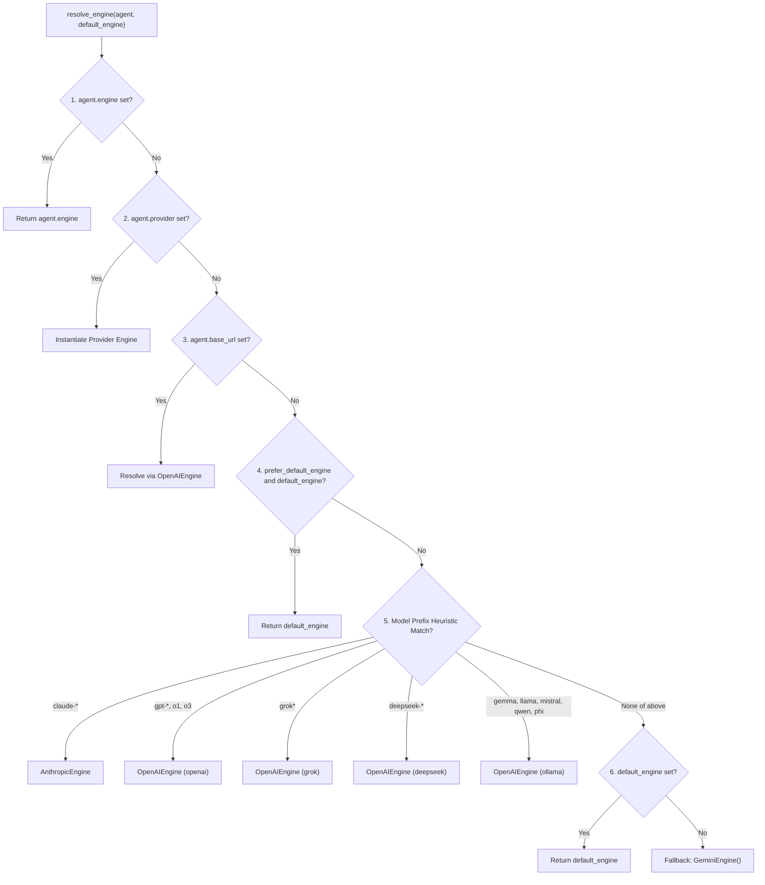

import { Callout } from 'fumadocs-ui/components/callout';
import { Tab, Tabs } from 'fumadocs-ui/components/tabs';
import { Step, Steps } from 'fumadocs-ui/components/steps';
import { Card, Cards } from 'fumadocs-ui/components/card';
import { VersionBadge } from '@/components/docs/VersionBadge';

`chatflow-agent` decouples agent reasoning and swarm orchestration from underlying language models through an engine abstraction layer. Every agent can communicate with a different foundation model—ranging from Google Gemini and Anthropic Claude to OpenAI, Groq, DeepSeek, and local Ollama instances—within a single shared conversation session.

## Architecture and Core Components

Every model interaction in the framework executes through a concrete implementation of `BaseEngine`. The engine translates normalized conversation messages and tool schemas into provider-specific API payloads, executes the request via asynchronous HTTP, and maps responses back into an `EngineTurnResult`.

```
+-------------------------------------------------------------------+
|                           Runner                                  |
+---------------------------------+---------------------------------+
                                  |
                   resolve_engine(agent, default_engine)
                                  |
                                  v
+---------------------------------+---------------------------------+
|                         BaseEngine                                |
|  - generate_turn_async(agent, history) -> EngineTurnResult        |
+----------+----------------------+--------------------+------------+
           |                      |                    |
           v                      v                    v
+----------+----------+  +--------+---------+  +-------+------------+
|    GeminiEngine     |  | AnthropicEngine  |  |   OpenAIEngine     |
| Direct REST v1beta  |  | Messages API v1  |  | OpenAI, Groq,      |
| Pooled in Runner    |  | Retry & Backoff  |  | DeepSeek, Ollama   |
+---------------------+  +------------------+  +--------------------+
```

### The BaseEngine Interface

All engines implement the abstract method `generate_turn_async`, which receives the active `Agent` and the entire conversation `history`:

```python
from chatflow_agent.core.engines.base import BaseEngine, EngineTurnResult
from chatflow_agent.types import Message, ToolCall

class CustomEchoEngine(BaseEngine):
    """Minimal custom engine demonstrating BaseEngine implementation."""

    async def generate_turn_async(
        self,
        agent,
        history: list[Message],
    ) -> EngineTurnResult:
        last_message = history[-1].content if history else "Empty"
        return EngineTurnResult(
            text=f"Echo: {last_message}",
            tool_calls=[],
        )
```

### Normalized Turn Results

The engine returns an `EngineTurnResult` containing:

| Attribute | Type | Description |
| :--- | :--- | :--- |
| `text` | `str \| None` | Generated assistant textual response. |
| `tool_calls` | `list[ToolCall]` | Structured tool execution requests requested by the model. |
| `raw_response` | `Any \| None` | Native provider response payload for debugging or token inspection. |

### Universal Tool Call ID Normalization

When multi-agent handoffs occur between different model families (for instance, handing off from Anthropic Claude to OpenAI GPT-4o), historical messages retain tool call IDs issued by the previous model. Because different providers impose conflicting ID validation constraints (for example, OpenAI rejects tool call IDs exceeding 40 characters), `chatflow-agent` uses deterministic replacement:

```python
# [min-version: 0.4.0rc1]
# [executable]
from chatflow_agent.core.engines.base import replacement_tool_call_id

original_id = "toolu_01A098bC45dEf67gHiJkLmNoPqRsTuVwXyZ"
safe_id = replacement_tool_call_id(original_id)
# Returns: "call_" followed by 24 deterministic hex characters
# History preserves original_id while provider requests use safe_id
```

## Dynamic Engine Resolution

When an agent executes a turn, `chatflow_agent.core.engines.factory.resolve_engine` inspects agent properties and applies a strict 7-level precedence hierarchy:



### Resolution Order Details

1. **Explicit Engine:** `agent.engine` takes precedence if directly assigned on the agent instance.
2. **Explicit Provider:** `agent.provider` matches recognized strings (`"gemini"`, `"google"`, `"anthropic"`, `"claude"`, `"openai"`, `"grok"`, `"xai"`, `"ollama"`, `"gemma"`, `"deepseek"`, `"groq"`).
3. **Custom Base URL:** `agent.base_url` without a provider. Official endpoints map to their provider; other URLs use `OpenAIEngine(provider="openai")` and require an explicit key unless local. Setting only `agent.api_key` does not select an engine.
4. **Caller Override:** `default_engine` supplied with `prefer_default_engine=True`. `Runner` does this when you pass `Runner(engine=...)` explicitly, so an explicit engine wins over model-name prefixes.
5. **Model Name Prefix Heuristics:** Matches recognizable prefixes (`claude-`, `gpt-`, `o1`, `o3`, `grok`, `deepseek-`, `gemma`, `llama`, `mistral`, `qwen`, `phi`). This prevents a Claude model from accidentally falling back to a Gemini default.
6. **Default Runner Engine:** The implicit `GeminiEngine` built by `Runner` when no engine was passed (e.g., from `Runner(starting_agent=..., api_key=...)`), used for Gemini and unrecognized models.
7. **Ultimate Fallback:** Standard `GeminiEngine(api_key=...)`.

## Security Rules and Credential Isolation

A common vulnerability in multi-provider frameworks is credential leakage: sending cloud API keys (such as `OPENAI_API_KEY`) to untrusted proxy endpoints or third-party gateways. `chatflow-agent` enforces strict credential isolation:

<Callout type="warn" title="Credential Isolation Policy">
Environment keys (`OPENAI_API_KEY`, `ANTHROPIC_API_KEY`, `DEEPSEEK_API_KEY`) are **strictly transmitted only to their official provider HTTPS endpoints**. Passing a custom `base_url` without providing an explicit `api_key` raises a `ValueError` rather than leaking global cloud credentials.
</Callout>

```python
from chatflow_agent import Agent
from chatflow_agent.core.engines.openai_compatible import OpenAIEngine

# [CORRECT] Official endpoints read OPENAI_API_KEY automatically
official_engine = OpenAIEngine(provider="openai")

# [CORRECT] Custom proxies require explicit credentials
proxy_engine = OpenAIEngine(
    base_url="https://proxy.internal.corp/v1",
    api_key="internal-proxy-token",
)

# [CORRECT] Local development hosts are exempted from credential requirements
local_engine = OpenAIEngine(
    base_url="http://localhost:11434/v1",
    provider="ollama",
)
```

## Version Evolution: v0.3.4 vs v0.4.0rc1

Understanding architectural differences between releases helps choose the right configuration:

| Architectural Area | Baseline `v0.3.4` (Stable) | Prerelease `v0.4.0rc1` |
| :--- | :--- | :--- |
| **Gemini Engine Runtime** | Powered by the Google `google-genai` SDK (`from google import genai`). | **Zero-SDK Lock-in**: Re-engineered with native asynchronous `httpx` directly against `https://generativelanguage.googleapis.com/v1beta`. |
| **Connection Pooling** | Separate connection handles per request. | **Runner Lifespan Client Pool** for `GeminiEngine`: inside `async with runner:`, Gemini requests share one pooled `httpx` client. OpenAI-compatible and Anthropic engines still use a client per request attempt. |
| **Provider Presets** | OpenAI, Grok/xAI, Ollama/Gemma, DeepSeek, and Groq. | Same presets; the `deepseek-` model prefix is now recognized. |
| **Credential Guard** | `_resolve_api_key` restricts environment keys to exact official endpoints and requires explicit credentials for custom remote URLs. | Same guard; `GeminiEngine` additionally never follows redirects and redacts its key from errors. |
| **Engine Resolution** | A `Runner`'s default engine wins before model-name prefixes, so non-Gemini models need `provider=` or `engine=`. | Model-name prefixes win over the implicit default engine; an explicit `Runner(engine=...)` still wins over prefixes. |

<Callout type="info" title="Runner Connection Pooling in v0.4.0rc1">
In `v0.4.0rc1`, wrap runner executions inside `async with runner:` so that Gemini requests reuse one pooled HTTP client across turns. `Runner.run()`, `TelegramChannel.run()`, and the `WhatsAppChannel` app open this scope automatically:

```python
# [min-version: 0.4.0rc1]
# [no-exec: requires real provider engine for turn execution]
import asyncio
from chatflow_agent import Agent, Runner

agent = Agent(name="Assistant", instructions="Be helpful.")
runner = Runner(starting_agent=agent)

async def main():
    async with runner:
        res1 = await runner.run_async("session-1", "Hello")
        res2 = await runner.run_async("session-1", "How are you?")
        print(res1.content, res2.content)

asyncio.run(main())
```
</Callout>

## Next Steps

Explore detailed setup guides for each provider:

<Cards>
  <Card title="OpenAI & Compatible Endpoints" href="/en/docs/providers/openai">
    Configure GPT-4o, Groq, DeepSeek, and custom proxy gateways.
  </Card>
  <Card title="Google Gemini & Anthropic Claude" href="/en/docs/providers/gemini-anthropic">
    Direct REST Gemini v1beta and Anthropic Messages API integrations.
  </Card>
  <Card title="Local Models with Ollama" href="/en/docs/providers/ollama">
    Run Gemma 2, Llama 3, and Mistral on local hardware with zero cloud fees.
  </Card>
</Cards>
