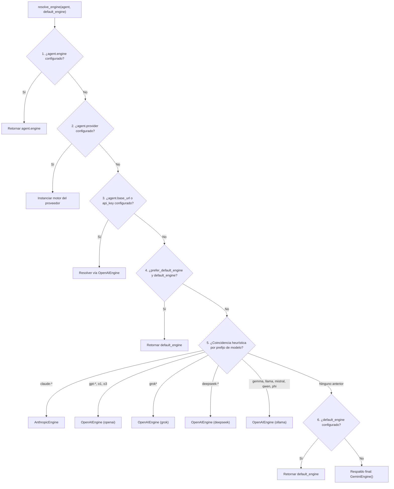

import { Callout } from 'fumadocs-ui/components/callout';
import { Tab, Tabs } from 'fumadocs-ui/components/tabs';
import { Step, Steps } from 'fumadocs-ui/components/steps';
import { Card, Cards } from 'fumadocs-ui/components/card';
import { VersionBadge } from '@/components/docs/VersionBadge';

`chatflow-agent` desacopla el razonamiento de los agentes y la orquestación del enjambre de los modelos de lenguaje subyacentes mediante una capa de abstracción de motores (`Engine`). Cada agente puede comunicarse con un modelo fundacional distinto —desde Google Gemini y Anthropic Claude hasta OpenAI, Groq, DeepSeek e instancias locales de Ollama— dentro de una misma sesión conversacional compartida.

## Arquitectura y Componentes Centrales

Cada interacción con un modelo en el framework se ejecuta mediante una implementación concreta de `BaseEngine`. El motor traduce mensajes normalizados y esquemas de herramientas a las cargas útiles de API específicas de cada proveedor, ejecuta la petición mediante HTTP asíncrono y mapea las respuestas a un `EngineTurnResult`.

```
+-------------------------------------------------------------------+
|                           Runner                                  |
+---------------------------------+---------------------------------+
                                  |
                   resolve_engine(agent, default_engine)
                                  |
                                  v
+---------------------------------+---------------------------------+
|                         BaseEngine                                |
|  - generate_turn_async(agent, history) -> EngineTurnResult        |
+----------+----------------------+--------------------+------------+
           |                      |                    |
           v                      v                    v
+----------+----------+  +--------+---------+  +-------+------------+
|    GeminiEngine     |  | AnthropicEngine  |  |   OpenAIEngine     |
| Direct REST v1beta  |  | Messages API v1  |  | OpenAI, Groq,      |
| Connection Pooling  |  | Retry & Backoff  |  | DeepSeek, Ollama   |
+---------------------+  +------------------+  +--------------------+
```

### La Interfaz `BaseEngine`

Todos los motores implementan el método abstracto `generate_turn_async`, el cual recibe el `Agent` activo y el historial completo de la conversación (`history`):

```python
from chatflow_agent.core.engines.base import BaseEngine, EngineTurnResult
from chatflow_agent.types import Message, ToolCall

class CustomEchoEngine(BaseEngine):
    """Minimal custom engine demonstrating BaseEngine implementation."""

    async def generate_turn_async(
        self,
        agent,
        history: list[Message],
    ) -> EngineTurnResult:
        last_message = history[-1].content if history else "Empty"
        return EngineTurnResult(
            text=f"Echo: {last_message}",
            tool_calls=[],
        )
```

### Resultados de Turno Normalizados

El motor retorna un `EngineTurnResult` que contiene:

| Atributo | Tipo | Descripción |
| :--- | :--- | :--- |
| `text` | `str \| None` | Respuesta textual generada por el asistente. |
| `tool_calls` | `list[ToolCall]` | Solicitudes estructuradas de ejecución de herramientas requeridas por el modelo. |
| `raw_response` | `Any \| None` | Carga útil nativa de respuesta del proveedor para depuración o análisis de tokens. |

### Normalización Universal de IDs de Llamadas a Herramientas

Cuando se producen transferencias multi-agente entre familias heterogéneas de modelos (por ejemplo, transfiriendo de Anthropic Claude a OpenAI GPT-4o), los mensajes históricos conservan IDs de llamadas emitidos por el modelo previo. Dado que distintos proveedores imponen restricciones de validación conflictivas (por ejemplo, OpenAI rechaza IDs superiores a 40 caracteres), `chatflow-agent` aplica un reemplazo determinista:

```python
# [no-exec: illustrative tool call normalization]
import hashlib

def normalize_tool_call_id(raw_id: str) -> str:
    """Normalize tool call IDs across heterogeneous model providers."""
    return f"call_{hashlib.sha256(raw_id.encode()).hexdigest()[:24]}"

original_id = "toolu_01A098bC45dEf67gHiJkLmNoPqRsTuVwXyZ"
safe_id = normalize_tool_call_id(original_id)
# El historial preserva original_id mientras las peticiones al proveedor usan safe_id
```

## Resolución Dinámica de Motores

Cuando un agente ejecuta un turno, `chatflow_agent.core.engines.factory.resolve_engine` inspecciona las propiedades del agente y aplica una jerarquía estricta de 7 niveles de precedencia:



### Detalles del Orden de Resolución

1. **Motor Explícito:** `agent.engine` tiene prioridad si está asignado directamente en la instancia del agente.
2. **Proveedor Explícito:** `agent.provider` coincide con cadenas reconocidas (`"gemini"`, `"google"`, `"anthropic"`, `"claude"`, `"openai"`, `"grok"`, `"xai"`, `"ollama"`, `"gemma"`, `"deepseek"`, `"groq"`).
3. **Conexión Personalizada:** `agent.base_url` o `agent.api_key` sin proveedor. Los endpoints oficiales se mapean automáticamente a su configuración de proveedor correspondiente; en caso contrario, se asume `"openai"`.
4. **Anulación por el Invocador:** `default_engine` suministrado con `prefer_default_engine=True` (utilizado cuando el llamador fuerza deliberadamente un mock de pruebas o un motor de runner específico).
5. **Heurística de Prefijo del Nombre del Modelo:** Reconoce prefijos (`claude-`, `gpt-`, `o1`, `o3`, `grok`, `deepseek-`, `gemma`, `llama`, `mistral`, `qwen`, `phi`). Esto evita que un modelo Claude retroceda accidentalmente a un motor Gemini por defecto.
6. **Motor Predeterminado del Runner:** El motor configurado en `Runner` (ej. desde `Runner(starting_agent=..., api_key=...)`).
7. **Respaldo Absoluto:** `GeminiEngine(api_key=...)` estándar.

## Reglas de Seguridad y Aislamiento de Credenciales

Una vulnerabilidad común en arquitecturas multiproveedor es la fuga de credenciales: enviar claves de API en la nube (como `OPENAI_API_KEY`) a proxies no confiables o pasarelas de terceros. `chatflow-agent` impone un aislamiento estricto de credenciales:

<Callout type="warn" title="Política de Aislamiento de Credenciales">
Las claves de entorno (`OPENAI_API_KEY`, `ANTHROPIC_API_KEY`, `DEEPSEEK_API_KEY`) son **transmitidas estrictamente solo a sus endpoints HTTPS oficiales**. Pasar un `base_url` personalizado sin proporcionar una `api_key` explícita genera un `ValueError` en lugar de filtrar credenciales globales de la nube.
</Callout>

```python
from chatflow_agent import Agent
from chatflow_agent.core.engines.openai_compatible import OpenAIEngine

# [CORRECTO] Endpoints oficiales leen OPENAI_API_KEY automáticamente
official_engine = OpenAIEngine(provider="openai")

# [CORRECTO] Proxies personalizados requieren credenciales explícitas
proxy_engine = OpenAIEngine(
    base_url="https://proxy.internal.corp/v1",
    api_key="internal-proxy-token",
)

# [CORRECTO] Servidores locales de desarrollo están exentos de requerir credenciales
local_engine = OpenAIEngine(
    base_url="http://localhost:11434/v1",
    provider="ollama",
)
```

## Evolución de Versiones: v0.3.4 vs v0.4.0rc1

Comprender las diferencias arquitectónicas entre versiones facilita la configuración adecuada:

| Área Arquitectónica | Línea Base `v0.3.4` (Estable) | Pre-lanzamiento `v0.4.0rc1` |
| :--- | :--- | :--- |
| **Entorno del Motor Gemini** | Impulsado por el SDK oficial de Google `google-genai` (`from google import genai`). | **Cero Dependencia Cautiva**: Rediseñado con `httpx` asíncrono nativo directamente contra `https://generativelanguage.googleapis.com/v1beta`. |
| **Pool de Conexiones** | Conexiones independientes por cada petición. | **Pool de Clientes en el Ciclo de Vida del Runner**: `_ClientPool` gestiona conexiones persistentes (keepalive) compartidas entre turnos con `async with runner:`. |
| **Preajustes de Proveedores** | OpenAI, Grok, Ollama. | Preajustes ampliados: `deepseek`, `groq`, `xai`, `gemma`, con verificación estricta de base URL. |
| **Protección de Credenciales** | Respaldo básico de variables de entorno. | Verificación *fail-closed* mediante `_resolve_api_key` impidiendo fugas de claves a endpoints externos. |

<Callout type="info" title="Nota de Pre-lanzamiento: Pool de Conexiones en v0.4.0rc1">
En la versión estable `v0.3.4`, los turnos se ejecutan directamente mediante `await runner.run_async(...)`. En `v0.4.0rc1`, engloba la ejecución del runner dentro de `async with runner:` para habilitar conexiones HTTP reutilizables entre turnos:

```python
# [no-exec: requires real provider engine for turn execution]
import asyncio
from chatflow_agent import Agent, Runner

agent = Agent(name="Assistant", instructions="Be helpful.")
runner = Runner(starting_agent=agent)

async def main():
    # En v0.3.x, ejecuta turnos asíncronos directamente sobre la instancia del runner
    res1 = await runner.run_async("session-1", "Hello")
    res2 = await runner.run_async("session-1", "How are you?")
    print(res1.content, res2.content)

asyncio.run(main())
```
</Callout>

## Próximos Pasos

Explora las guías detalladas para cada proveedor:

<Cards>
  <Card title="OpenAI y Endpoints Compatibles" href="/es/docs/v0.3/providers/openai">
    Configura GPT-4o, Groq, DeepSeek y pasarelas proxy corporativas.
  </Card>
  <Card title="Google Gemini y Anthropic Claude" href="/es/docs/v0.3/providers/gemini-anthropic">
    Integración REST directa con Gemini v1beta y Anthropic Messages API.
  </Card>
  <Card title="Modelos Locales con Ollama" href="/es/docs/v0.3/providers/ollama">
    Ejecuta Gemma 2, Llama 3 y Mistral en hardware local sin costos en la nube.
  </Card>
</Cards>
