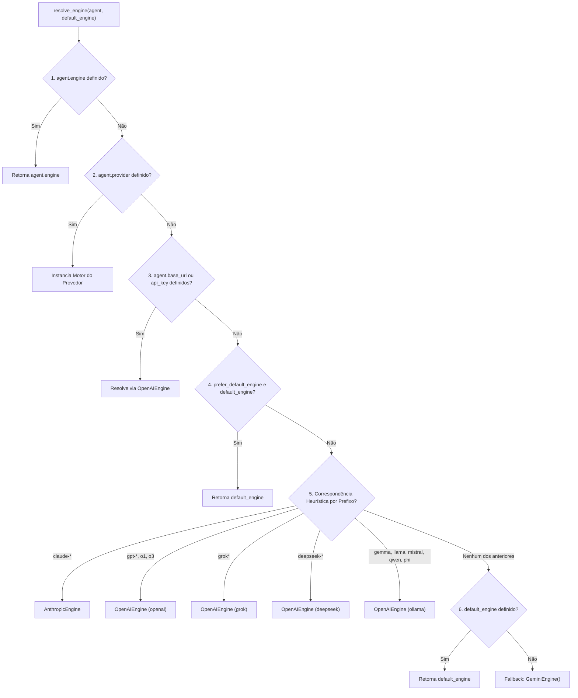

import { Callout } from 'fumadocs-ui/components/callout';
import { Tab, Tabs } from 'fumadocs-ui/components/tabs';
import { Step, Steps } from 'fumadocs-ui/components/steps';
import { Card, Cards } from 'fumadocs-ui/components/card';
import { VersionBadge } from '@/components/docs/VersionBadge';

O `chatflow-agent` desacopla o raciocínio dos agentes e a orquestração de enxames dos modelos de linguagem subjacentes através de uma camada de abstração de motores (*engines*). Cada agente pode se comunicar com um modelo de base diferente — desde Google Gemini e Anthropic Claude até OpenAI, Groq, DeepSeek e instâncias locais do Ollama — dentro de uma única sessão de conversa compartilhada.

## Arquitetura e Componentes Centrais

Toda interação com modelos no framework executa através de uma implementação concreta de `BaseEngine`. O motor traduz mensagens de conversa e esquemas de ferramentas normalizados em payloads de API específicos do provedor, executa a requisição via HTTP assíncrono e mapeia as respostas de volta em um `EngineTurnResult`.

```
+-------------------------------------------------------------------+
|                           Runner                                  |
+---------------------------------+---------------------------------+
                                  |
                   resolve_engine(agent, default_engine)
                                  |
                                  v
+---------------------------------+---------------------------------+
|                         BaseEngine                                |
|  - generate_turn_async(agent, history) -> EngineTurnResult        |
+----------+----------------------+--------------------+------------+
           |                      |                    |
           v                      v                    v
+----------+----------+  +--------+---------+  +-------+------------+
|    GeminiEngine     |  | AnthropicEngine  |  |   OpenAIEngine     |
| Direct REST v1beta  |  | Messages API v1  |  | OpenAI, Groq,      |
| Connection Pooling  |  | Retry & Backoff  |  | DeepSeek, Ollama   |
+---------------------+  +------------------+  +--------------------+
```

### A Interface `BaseEngine`

Todos os motores implementam o método abstrato `generate_turn_async`, que recebe o `Agent` ativo e todo o histórico da conversa (`history`):

```python
from chatflow_agent.core.engines.base import BaseEngine, EngineTurnResult
from chatflow_agent.types import Message, ToolCall

class CustomEchoEngine(BaseEngine):
    """Minimal custom engine demonstrating BaseEngine implementation."""

    async def generate_turn_async(
        self,
        agent,
        history: list[Message],
    ) -> EngineTurnResult:
        last_message = history[-1].content if history else "Empty"
        return EngineTurnResult(
            text=f"Echo: {last_message}",
            tool_calls=[],
        )
```

### Resultados Normalizados de Turno

O motor retorna um `EngineTurnResult` contendo:

| Atributo | Tipo | Descrição |
| :--- | :--- | :--- |
| `text` | `str \| None` | Resposta textual gerada pelo assistente. |
| `tool_calls` | `list[ToolCall]` | Requisições estruturadas de execução de ferramentas solicitadas pelo modelo. |
| `raw_response` | `Any \| None` | Carga de resposta nativa do provedor para depuração ou inspeção de tokens. |

### Normalização Universal de IDs de Chamada de Ferramenta

Quando ocorrem handoffs multiagente entre diferentes famílias de modelos (por exemplo, transferindo de Anthropic Claude para OpenAI GPT-4o), mensagens anteriores retêm IDs de chamadas de ferramentas emitidos pelo modelo anterior. Como diferentes provedores impõem restrições de validação conflitantes (por exemplo, a OpenAI rejeita IDs que ultrapassem 40 caracteres), o `chatflow-agent` utiliza substituição determinística:

```python
# [no-exec: illustrative tool call normalization]
import hashlib

def normalize_tool_call_id(raw_id: str) -> str:
    """Normalize tool call IDs across heterogeneous model providers."""
    return f"call_{hashlib.sha256(raw_id.encode()).hexdigest()[:24]}"

original_id = "toolu_01A098bC45dEf67gHiJkLmNoPqRsTuVwXyZ"
safe_id = normalize_tool_call_id(original_id)
# History preserves original_id while provider requests use safe_id
```

## Resolução Dinâmica de Motores

Quando um agente executa um turno, `chatflow_agent.core.engines.factory.resolve_engine` inspeciona os atributos do agente e aplica uma hierarquia estrita de 7 níveis de precedência:



### Detalhes da Ordem de Resolução

1. **Motor Explícito:** `agent.engine` tem prioridade máxima se atribuído diretamente na instância do agente.
2. **Provedor Explícito:** `agent.provider` corresponde a strings reconhecidas (`"gemini"`, `"google"`, `"anthropic"`, `"claude"`, `"openai"`, `"grok"`, `"xai"`, `"ollama"`, `"gemma"`, `"deepseek"`, `"groq"`).
3. **Conexão Customizada:** `agent.base_url` ou `agent.api_key` sem provedor. Endpoints oficiais mapeiam automaticamente para suas respectivas configurações de provedor; caso contrário, o padrão é `"openai"`.
4. **Sobrescrita do Chamador:** `default_engine` fornecido com `prefer_default_engine=True` (usado quando o chamador força deliberadamente um mock de teste ou motor específico de runner).
5. **Heurística de Prefixos de Nomes de Modelo:** Reconhece prefixos conhecidos (`claude-`, `gpt-`, `o1`, `o3`, `grok`, `deepseek-`, `gemma`, `llama`, `mistral`, `qwen`, `phi`). Isso impede que um modelo Claude recaia acidentalmente para o padrão Gemini.
6. **Motor Padrão do Runner:** O motor construído pelo `Runner` (ex.: a partir de `Runner(starting_agent=..., api_key=...)`).
7. **Fallback Final:** Padrão `GeminiEngine(api_key=...)`.

## Regras de Segurança e Isolamento de Credenciais

Uma vulnerabilidade frequente em frameworks multiprovedor é o vazamento de credenciais: envio de chaves de API de nuvem (como `OPENAI_API_KEY`) para proxies corporativos ou gateways de terceiros. O `chatflow-agent` impõe isolamento rigoroso de credenciais:

<Callout type="warn" title="Política de Isolamento de Credenciais">
Chaves de ambiente (<code>OPENAI_API_KEY</code>, <code>ANTHROPIC_API_KEY</code>, <code>DEEPSEEK_API_KEY</code>) são <strong>transmitidas estritamente apenas para os endpoints oficiais HTTPS de seus provedores</strong>. Informar um <code>base_url</code> customizado sem fornecer uma <code>api_key</code> explícita levanta um <code>ValueError</code> em vez de expor credenciais globais de nuvem.
</Callout>

```python
from chatflow_agent import Agent
from chatflow_agent.core.engines.openai_compatible import OpenAIEngine

# [CORRETO] Endpoints oficiais leem OPENAI_API_KEY automaticamente
official_engine = OpenAIEngine(provider="openai")

# [CORRETO] Proxies personalizados exigem credenciais explícitas
proxy_engine = OpenAIEngine(
    base_url="https://proxy.internal.corp/v1",
    api_key="internal-proxy-token",
)

# [CORRETO] Hosts de desenvolvimento local são isentos de exigência de credenciais
local_engine = OpenAIEngine(
    base_url="http://localhost:11434/v1",
    provider="ollama",
)
```

## Evolução de Versões: v0.3.4 vs v0.4.0rc1

Compreender as diferenças arquiteturais entre versões auxilia na escolha da configuração ideal:

| Área Arquitetural | Linha de Base `v0.3.4` (Estável) | Pré-lançamento `v0.4.0rc1` |
| :--- | :--- | :--- |
| **Motor Gemini em Tempo de Execução** | Baseado no SDK `google-genai` do Google (`from google import genai`). | **Zero Bloqueio de SDK**: Reimplementado com `httpx` assíncrono nativo diretamente contra `https://generativelanguage.googleapis.com/v1beta`. |
| **Pool de Conexões** | Manipuladores de conexão separados por requisição. | **Pool de Conexões com Ciclo de Vida do Runner**: O `_ClientPool` gerencia conexões persistentes *keepalive* compartilhadas entre turnos via `async with runner:`. |
| **Predefinições de Provedores** | OpenAI, Grok, Ollama. | Predefinições expandidas: `deepseek`, `groq`, `xai`, `gemma`, com validação rigorosa de URL base. |
| **Guarda de Credenciais** | Fallback básico para chaves de ambiente. | Verificação de falha segura (*fail-closed*) em `_resolve_api_key` impedindo o vazamento de chaves para endpoints customizados. |

<Callout type="info" title="Nota de Prévia: Pool de Conexões na v0.4.0rc1">
Na versão estável `v0.3.4`, turnos são executados diretamente via <code>await runner.run_async(...)</code>. Na versão preliminar `v0.4.0rc1`, envolva as execuções do runner dentro de <code>async with runner:</code> para habilitar conexões HTTP persistentes (*keepalive*) compartilhadas entre turnos:

```python
# [no-exec: requires real provider engine for turn execution]
import asyncio
from chatflow_agent import Agent, Runner

agent = Agent(name="Assistant", instructions="Be helpful.")
runner = Runner(starting_agent=agent)

async def main():
    # Na v0.3.x, execute turnos assíncronos diretamente na instância do runner
    res1 = await runner.run_async("session-1", "Hello")
    res2 = await runner.run_async("session-1", "How are you?")
    print(res1.content, res2.content)

asyncio.run(main())
```
</Callout>

## Próximos Passos

Explore guias de configuração detalhados para cada provedor:

<Cards>
  <Card title="OpenAI e Endpoints Compatíveis" href="/pt-BR/docs/v0.3/providers/openai">
    Configure GPT-4o, Groq, DeepSeek e gateways proxy customizados.
  </Card>
  <Card title="Google Gemini e Anthropic Claude" href="/pt-BR/docs/v0.3/providers/gemini-anthropic">
    Integrações REST diretas com Gemini v1beta e Anthropic Messages API.
  </Card>
  <Card title="Modelos Locais com Ollama" href="/pt-BR/docs/v0.3/providers/ollama">
    Execute Gemma 2, Llama 3 e Mistral em hardware local sem custos de nuvem.
  </Card>
</Cards>
