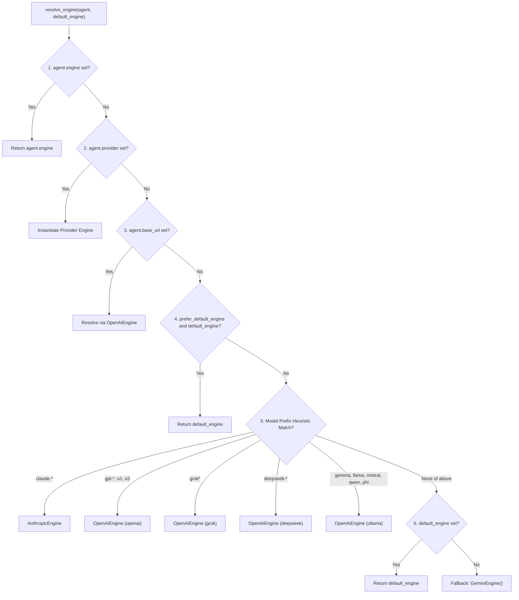

import { Callout } from 'fumadocs-ui/components/callout';
import { Tab, Tabs } from 'fumadocs-ui/components/tabs';
import { Step, Steps } from 'fumadocs-ui/components/steps';
import { Card, Cards } from 'fumadocs-ui/components/card';
import { VersionBadge } from '@/components/docs/VersionBadge';

O `chatflow-agent` desacopla o raciocínio dos agentes e a orquestração de enxames dos modelos de linguagem subjacentes através de uma camada de abstração de motores (*engines*). Cada agente pode se comunicar com um modelo de base diferente — desde Google Gemini e Anthropic Claude até OpenAI, Groq, DeepSeek e instâncias locais do Ollama — dentro de uma única sessão de conversa compartilhada.

## Arquitetura e Componentes Centrais

Toda interação com modelos no framework executa através de uma implementação concreta de `BaseEngine`. O motor traduz mensagens de conversa e esquemas de ferramentas normalizados em payloads de API específicos do provedor, executa a requisição via HTTP assíncrono e mapeia as respostas de volta em um `EngineTurnResult`.

```
+-------------------------------------------------------------------+
|                           Runner                                  |
+---------------------------------+---------------------------------+
                                  |
                   resolve_engine(agent, default_engine)
                                  |
                                  v
+---------------------------------+---------------------------------+
|                         BaseEngine                                |
|  - generate_turn_async(agent, history) -> EngineTurnResult        |
+----------+----------------------+--------------------+------------+
           |                      |                    |
           v                      v                    v
+----------+----------+  +--------+---------+  +-------+------------+
|    GeminiEngine     |  | AnthropicEngine  |  |   OpenAIEngine     |
| Direct REST v1beta  |  | Messages API v1  |  | OpenAI, Groq,      |
| Pooled in Runner    |  | Retry & Backoff  |  | DeepSeek, Ollama   |
+---------------------+  +------------------+  +--------------------+
```

### A Interface BaseEngine

Todos os motores implementam o método abstrato `generate_turn_async`, que recebe o `Agent` ativo e todo o histórico da conversa (`history`):

```python
from chatflow_agent.core.engines.base import BaseEngine, EngineTurnResult
from chatflow_agent.types import Message, ToolCall

class CustomEchoEngine(BaseEngine):
    """Minimal custom engine demonstrating BaseEngine implementation."""

    async def generate_turn_async(
        self,
        agent,
        history: list[Message],
    ) -> EngineTurnResult:
        last_message = history[-1].content if history else "Empty"
        return EngineTurnResult(
            text=f"Echo: {last_message}",
            tool_calls=[],
        )
```

### Resultados de Turno Normalizados

O motor retorna um `EngineTurnResult` contendo:

| Atributo | Tipo | Descrição |
| :--- | :--- | :--- |
| `text` | `str \| None` | Resposta textual gerada pelo assistente. |
| `tool_calls` | `list[ToolCall]` | Requisições estruturadas de execução de ferramentas solicitadas pelo modelo. |
| `raw_response` | `Any \| None` | Carga útil nativa de resposta do provedor para depuração ou inspeção de tokens. |

### Normalização Universal de IDs de Chamada de Ferramenta

Quando ocorrem transferências (*handoffs*) multiagente entre diferentes famílias de modelos (por exemplo, transferindo do Anthropic Claude para o OpenAI GPT-4o), as mensagens históricas retêm os IDs de chamadas de ferramentas emitidos pelo modelo anterior. Como diferentes provedores impõem restrições conflitantes de validação de IDs (por exemplo, a OpenAI rejeita IDs de chamada de ferramenta com mais de 40 caracteres), o `chatflow-agent` adota uma substituição determinística:

```python
# [min-version: 0.4.0rc1]
# [executable]
from chatflow_agent.core.engines.base import replacement_tool_call_id

original_id = "toolu_01A098bC45dEf67gHiJkLmNoPqRsTuVwXyZ"
safe_id = replacement_tool_call_id(original_id)
# Retorna: "call_" seguido por 24 caracteres hexadecimais determinísticos
# O histórico preserva original_id enquanto as requisições ao provedor usam safe_id
```

## Resolução Dinâmica de Motores

Quando um agente executa um turno, `chatflow_agent.core.engines.factory.resolve_engine` inspeciona as propriedades do agente e aplica uma hierarquia estrita de precedência em 7 níveis:



### Detalhes da Ordem de Resolução

1. **Motor Explícito:** `agent.engine` tem prioridade máxima se atribuído diretamente na instância do agente.
2. **Provedor Explícito:** `agent.provider` corresponde a strings reconhecidas (`"gemini"`, `"google"`, `"anthropic"`, `"claude"`, `"openai"`, `"grok"`, `"xai"`, `"ollama"`, `"gemma"`, `"deepseek"`, `"groq"`).
3. **URL Base Customizada:** `agent.base_url` sem provedor. Endpoints oficiais mapeiam para o respectivo provedor; outras URLs usam `OpenAIEngine(provider="openai")` e exigem uma chave explícita, a menos que sejam locais. Definir apenas `agent.api_key` não seleciona um motor.
4. **Sobrescrita do Chamador:** `default_engine` fornecido com `prefer_default_engine=True`. O `Runner` faz isso quando você passa `Runner(engine=...)` explicitamente, de modo que um motor explícito tem prioridade sobre os prefixos de nome de modelo.
5. **Heurísticas de Prefixo do Nome do Modelo:** Mapeia prefixos reconhecíveis (`claude-`, `gpt-`, `o1`, `o3`, `grok`, `deepseek-`, `gemma`, `llama`, `mistral`, `qwen`, `phi`). Isso evita que um modelo Claude acidentalmente reverta para um padrão Gemini.
6. **Motor Padrão do Runner:** O `GeminiEngine` implícito construído pelo `Runner` quando nenhum motor foi passado (ex.: a partir de `Runner(starting_agent=..., api_key=...)`), usado para modelos Gemini e não reconhecidos.
7. **Fallback Final:** `GeminiEngine(api_key=...)` padrão.

## Regras de Segurança e Isolamento de Credenciais

Uma vulnerabilidade comum em frameworks de múltiplos provedores é o vazamento de credenciais: enviar chaves de API de nuvem (como `OPENAI_API_KEY`) para endpoints proxy não confiáveis ou gateways de terceiros. O `chatflow-agent` impõe um isolamento rigoroso de credenciais:

<Callout type="warn" title="Política de Isolamento de Credenciais">
Chaves de ambiente (`OPENAI_API_KEY`, `ANTHROPIC_API_KEY`, `DEEPSEEK_API_KEY`) são **estritamente transmitidas apenas para os endpoints HTTPS oficiais de seus respectivos provedores**. Passar uma `base_url` customizada sem fornecer uma `api_key` explícita levanta um `ValueError` em vez de vazar credenciais globais da nuvem.
</Callout>

```python
from chatflow_agent import Agent
from chatflow_agent.core.engines.openai_compatible import OpenAIEngine

# [CORRECT] Endpoints oficiais leem OPENAI_API_KEY automaticamente
official_engine = OpenAIEngine(provider="openai")

# [CORRECT] Proxies customizados exigem credenciais explícitas
proxy_engine = OpenAIEngine(
    base_url="https://proxy.internal.corp/v1",
    api_key="internal-proxy-token",
)

# [CORRECT] Hosts de desenvolvimento local são isentos de requisitos de credenciais
local_engine = OpenAIEngine(
    base_url="http://localhost:11434/v1",
    provider="ollama",
)
```

## Evolução de Versões: v0.3.4 vs v0.4.0rc1

Compreender as diferenças arquiteturais entre as versões ajuda a escolher a configuração ideal:

| Área Arquitetural | Linha Base `v0.3.4` (Estável) | Pré-lançamento `v0.4.0rc1` |
| :--- | :--- | :--- |
| **Runtime do Gemini Engine** | Baseado no SDK `google-genai` do Google (`from google import genai`). | **Zero Bloqueio de SDK**: Reformulado com `httpx` assíncrono nativo diretamente contra `https://generativelanguage.googleapis.com/v1beta`. |
| **Pools de Conexões** | Handles de conexão separados por requisição. | **Pool de Clientes no Ciclo de Vida do Runner** para o `GeminiEngine`: dentro de `async with runner:`, as requisições Gemini compartilham um único cliente `httpx` em pool. Os motores compatíveis com OpenAI e Anthropic continuam usando um cliente por tentativa de requisição. |
| **Presets de Provedores** | OpenAI, Grok/xAI, Ollama/Gemma, DeepSeek e Groq. | Os mesmos presets; o prefixo de modelo `deepseek-` agora é reconhecido. |
| **Proteção de Credenciais** | `_resolve_api_key` restringe as chaves de ambiente aos endpoints oficiais exatos e exige credenciais explícitas para URLs remotas customizadas. | A mesma proteção; além disso, o `GeminiEngine` nunca segue redirecionamentos e remove sua chave dos erros. |
| **Resolução de Motores** | O motor padrão de um `Runner` tem prioridade sobre os prefixos de nome de modelo, portanto modelos não Gemini precisam de `provider=` ou `engine=`. | Os prefixos de nome de modelo têm prioridade sobre o motor padrão implícito; um `Runner(engine=...)` explícito continua tendo prioridade sobre os prefixos. |

<Callout type="info" title="Pool de Conexões do Runner na v0.4.0rc1">
Na `v0.4.0rc1`, envolva as execuções do runner dentro de `async with runner:` para que as requisições Gemini reutilizem um único cliente HTTP em pool entre turnos. `Runner.run()`, `TelegramChannel.run()` e o app do `WhatsAppChannel` abrem esse escopo automaticamente:

```python
# [min-version: 0.4.0rc1]
# [no-exec: requires real provider engine for turn execution]
import asyncio
from chatflow_agent import Agent, Runner

agent = Agent(name="Assistant", instructions="Be helpful.")
runner = Runner(starting_agent=agent)

async def main():
    async with runner:
        res1 = await runner.run_async("session-1", "Hello")
        res2 = await runner.run_async("session-1", "How are you?")
        print(res1.content, res2.content)

asyncio.run(main())
```
</Callout>

## Próximos Passos

Explore os guias detalhados de configuração para cada provedor:

<Cards>
  <Card title="OpenAI e Endpoints Compatíveis" href="/pt-BR/docs/v0.4/providers/openai">
    Configure GPT-4o, Groq, DeepSeek e gateways proxy corporativos.
  </Card>
  <Card title="Google Gemini e Anthropic Claude" href="/pt-BR/docs/v0.4/providers/gemini-anthropic">
    Integração direta via REST com Gemini v1beta e Anthropic Messages API.
  </Card>
  <Card title="Modelos Locais com Ollama" href="/pt-BR/docs/v0.4/providers/ollama">
    Execute Gemma 2, Llama 3 e Mistral em hardware local com zero custos em nuvem.
  </Card>
</Cards>
